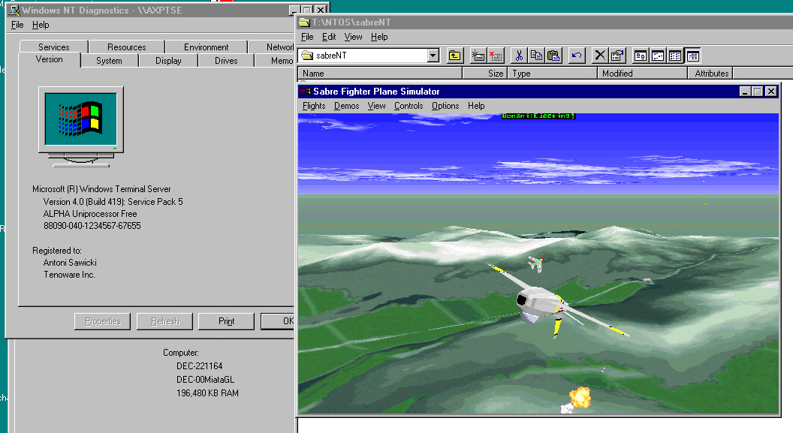

# SABRE Fighter Plane Simulator



Windows NT RISC Port

Builds with Visual Studio 4.0, CL 10.

Supported on

- Alpha AXP
- MIPS
- PowerPC

## Download

The game needs asset and data files. You need to download this [whole folder](https://github.com/tenox7/sabreNT/archive/refs/heads/master.zip) and run one of the exe files for your platform.


## PINT (Windows NT on the Raspberry Pi)

The releases have `sabre-pint35-arm.zip` for PINT 3.5 and `sabre-pint40-arm.zip` for PINT 4.0:
the game with its data, built with the PINT SDK in Docker
([tenox7/pint35sdk](https://hub.docker.com/r/tenox7/pint35sdk) for PINT 3.5,
[tenox7/pint40sdk](https://hub.docker.com/r/tenox7/pint40sdk) for PINT 4.0;
their page tells how to set them up once):

```
docker run --rm -v msvc-arm32:/opt/msvc -v "$PWD":/src tenox7/pint40sdk nmake
```

NT 3.5 has the joystick API of Windows 3.1, so on PINT 3.5 the game reads only the joystick's X, Y and buttons.

## Credits

Copyright (c) 1997/1998 by Dan Hammer
